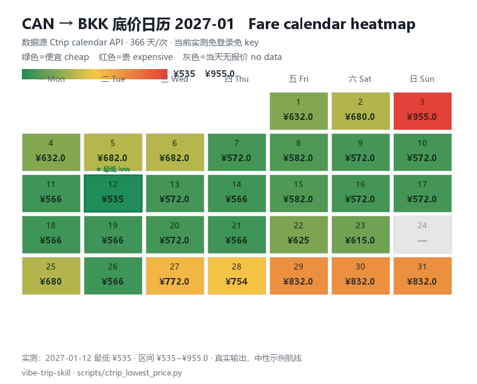
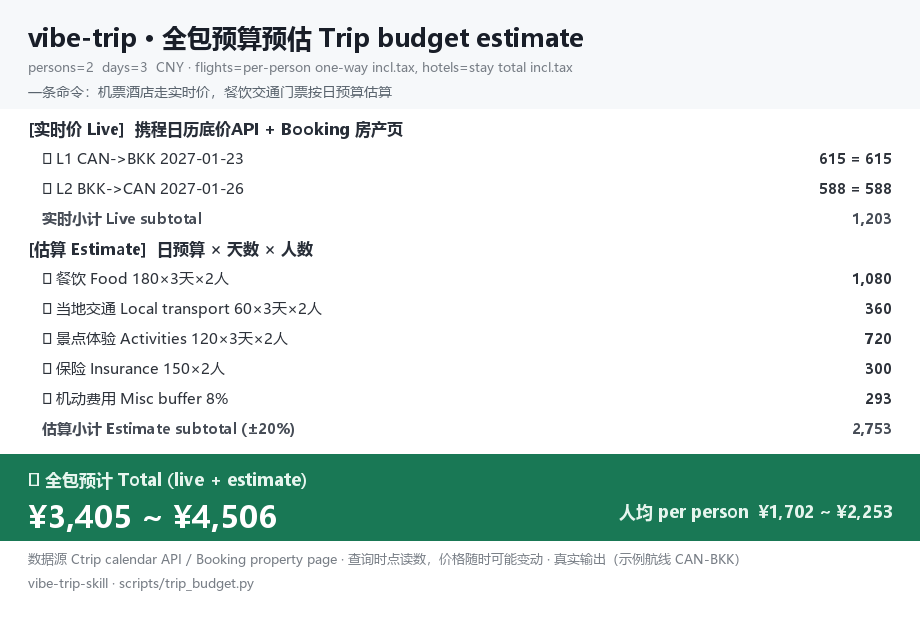

# vibe-trip-skill 🌏✈️

[](LICENSE)
[](https://github.com/SPA3K/vibe-trip-skill/stargazers)
[](scripts/)
[](README.md)

**A one-stop travel skill driven by travel personality, needs, and budget together**: start from who you are and what you want, derive the destination and itinerary, compare prices across multiple sources, then hand the watch job to a cron. Formerly `trip-planner`, renamed at 2.0.

[中文](README.md)

| Standalone scripts | Calendar floor price | API dependency | Delivery | Docs |
|---|---|---|---|---|
| **6** | **366** days per call | **0** keys (verified today), no login | silent when nothing changes | CN + EN |

## 5-minute quickstart

Real prices before installing anything:

```bash
python scripts/ctrip_lowest_price.py --dep CAN --arr BKK --date 2027-06-10 --window 3
```

> ⚠️ Pass **city codes, not airport codes**: for Beijing use `BJS`, never `PEK`/`PKX` (for multi-airport cities an airport code returns an all-zero calendar; verified 2026-11).

For flight numbers, hotel checks, and the price watch, install the browser driver once (talks to your local Chrome over CDP, default `http://127.0.0.1:9333`):

```bash
pip install playwright
python scripts/ctrip_flight_list.py --dep can --arr bkk --date 2027-06-10
```

Script output is Chinese; common setup errors (missing playwright, missing config, unreachable CDP) print bilingually.

## Pain points and fixes

| What usually goes wrong | What this repo does |
|---|---|
| Ten tabs open for comparison, stale prices everywhere | One command returns a 366-day fare calendar; hotels read straight from the property page room table |
| A price watcher spams you all night | Silent contract: zero output when nothing changes, one message on a record low |
| Booking's search page reports "no availability" to automation | Reads the property page `#hprt-table` instead, filtered by room-type keywords |
| Ctrip's international login wall appears and disappears | Falls back to the no-login calendar API the moment `needUserLogin` shows up, so price tracking never stops |
| Windows cron shells have no bash, `.sh` jobs die instantly | `vibe_trip_entry.py`, stdlib-only, picks a Python that has playwright |
| Keeping two travellers on the same flight means eyeballing flight numbers | Same-aircraft matching pairs a through-itinerary with its connecting segment by flight number; the shared return leg gets a single-flight recommendation |

## One-stop pipeline

| Stage | What happens |
|---|---|
| 1️⃣ Personality and preference discovery | Travel pace, planner vs. spontaneous, photo/food/experience focus, risk tolerance |
| 2️⃣ Needs collection | Dates, party size, total budget, priorities, an explicit dislike list |
| 3️⃣ Destination selection | Score 2-3 options against the total budget behind a two-layer safety gate (CDC disease layer can veto; political landscape checked at booking and 15 days before departure) |
| 4️⃣ Structure and budget | Hotel budget allocated by function, nine-line budget table recalibrated on every change |
| 5️⃣ Hotel four-axis verification | Official info × guest reviews × map location × like-for-like pricing; identity hard rules (chain ≠ brand) |
| 6️⃣ Daily itinerary | Transport first, resort days left unpacked |
| 7️⃣ Multi-source price lookup | Flights and hotels across sources (table below) |
| 8️⃣ Continuous price watch | Record lows, same-aircraft pairing, rebook-before-cancel (section below) |

## Multi-source price comparison (current: Ctrip / Booking / Agoda)

| Target | Source | Verified facts (2026-11) |
|---|---|---|
| Flight floor price | Ctrip calendar API | **Currently verified** login-free and key-free (a third-party endpoint that may break when their access policy changes); 366 days of daily lows for any city pair in one call |
| Flight details | Ctrip list page | Flight numbers, times, every flight number of a through-itinerary; degrades gracefully behind the login wall |
| Hotel price | Booking property page | Room table with stay totals and refundable/non-refundable split, filtered by room keyword |
| Hotel price | Agoda property page | Pay = strikethrough minus discount; non-refundable rate picked by DOM parent-walk to avoid cross-matching |



## Continuous price monitoring

- **Record-low state machine**: `values / mins / alerted` keys; announce only a new low, never repeat an unchanged value, clear the key when the price rises past the threshold
- **Silent contract**: an empty stdout from the no_agent cron means nothing happened
- **Per-leg and per-order tracking**: each leg, each order subtotal, and the grand total keep separate record lows
- **Same-aircraft pairing**: the shared return leg recommends one flight for both travellers; through-itineraries are matched to connecting segments by flight number
- **Rebook-before-cancel**: a booked refundable hotel alerts when the listed price drops below what you paid, with the free-cancellation deadline as the decision window
- **Reference threshold**: order totals also report when they fall under your reference price

### Deployment: let it run itself

```bash
# Linux / macOS (crontab -e): twice a day, zero output when nothing changes
30 9,21 * * * cd /path/to/vibe-trip-skill && python3 scripts/vibe_trip_monitor.py

# Windows: Task Scheduler runs python directly (entry is a .py, no bash involved)
# Hermes: a no_agent sentinel job pointing at scripts/vibe_trip_entry.py, empty stdout = silent
```

State lives in `vibe_trip_state.json` (record-low and alerted keys prevent repeats across runs); copy `scripts/config.example.json` to start. Browser scripts need Chrome running with a debug port (CDP `http://127.0.0.1:9333`).

## Trip budget estimate (showcase)

One command computes the **whole package cost before you book**: flights and hotels at live prices, food/local transport/activities from the daily budget you fill in, delivered as a total range and per-person numbers.

```bash
python scripts/trip_budget.py
```



- Flights expand per passenger through `budget.flight_order` (usually the `grand` order); hotels use the stay total from the property page
- Persons/days/daily budget/insurance/buffer all live in `config.budget`; estimates automatically carry a ±20% band
- The fare calendar API returns CNY only, so budgets aggregate in CNY; standalone hotel checks accept `--currency`

## Architecture


## Integration: let your agent install it

One sentence to your agent:

> Install github.com/SPA3K/vibe-trip-skill as a skill

Your agent clones the repo into its skills directory (Hermes: `~/.hermes/skills/travel/`, Claude Code: `~/.claude/skills/`) and follows `SKILL_EN.md` (English) or `SKILL.md` (full Chinese edition) from there.

The package ships two layers, ready to use right away:

**Planning layer**: load `SKILL.md` and follow the ten-step flow (needs → budget-based destination screening → safety checks → structure → hotel verification → itinerary → calibration → price lookup → price watch → delivery, including the fixed 15-days-before-departure double re-check).

**Tool layer**: the five scripts in `scripts/` run directly from the command line.

```bash
python scripts/ctrip_lowest_price.py --dep CAN --arr BKK --date 2027-06-10 --window 3
python scripts/ctrip_flight_list.py --dep can --arr bkk --date 2027-06-10
python scripts/hotel_price_check.py --platform booking \
  --url "https://www.booking.com/hotel/th/xxx.html" \
  --checkin 2027-06-10 --checkout 2027-06-17 --nights 7 --room-must Deluxe
python scripts/vibe_trip_monitor.py --verbose   # one local watch run
```

Browser scripts attach over CDP to a real browser (cua-driver and Playwright both talk to the same endpoint), so a QR-code login state survives across runs. Copy `scripts/config.example.json` to a local `vibe_trip_config.json`; real itinerary parameters stay local and never enter the repo.

## Repository layout

```
vibe-trip-skill/
├── README.md / README_EN.md   # bilingual docs
├── SKILL.md                   # skill definition: ten-step flow + toolbox + gotchas
├── LICENSE
├── assets/
│   ├── architecture.svg
│   ├── fare_calendar_heatmap.png
│   └── budget_estimate.png
└── scripts/
    ├── ctrip_lowest_price.py  #   Ctrip calendar floor price (no-login API as verified, stdlib only)
    ├── ctrip_flight_list.py   #   Ctrip flight list (numbers / times / through-stops)
    ├── hotel_price_check.py   #   Booking/Agoda hotel price check
    ├── trip_budget.py         #   trip budget estimate (showcase)
    ├── vibe_trip_monitor.py   #   multi-leg + multi-hotel watchdog
    ├── vibe_trip_entry.py     #   cron entry (bridges Windows' no-bash shells)
    └── config.example.json    #   config template (placeholders only)
```

## Acknowledgments

- Inspiration: [ai-goofish-monitor](https://github.com/Usagi-org/ai-goofish-monitor). The sentinel cron, cursor-based de-duplication, and silent contract used here borrow from the **Xianyu price-watch skill** (`xianyu-monitoring`) built on it. Thank you.
- The deep weeds of price watching (PIPL consent walls, region filters, anti-repeat alerts) are shared with the local `devops/web-price-monitoring` skill.

## Disclaimer

Prices are live page readings that move with inventory, cabin class, exchange rates, and member benefits; the checkout page is the authority. For destination safety, follow the latest advisories from embassies and authoritative bodies.

## License

MIT.
