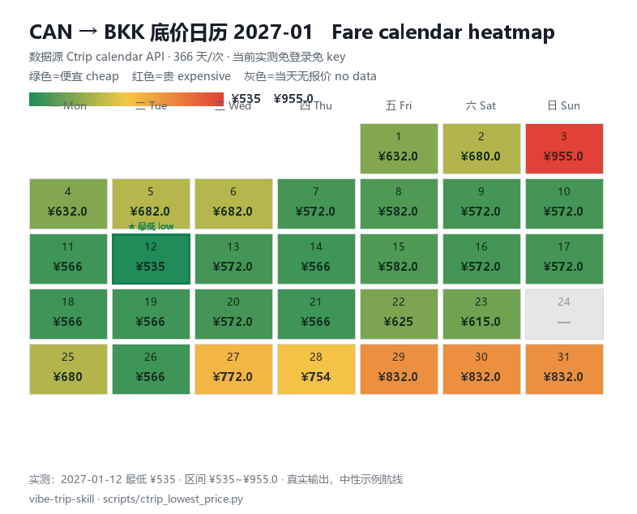
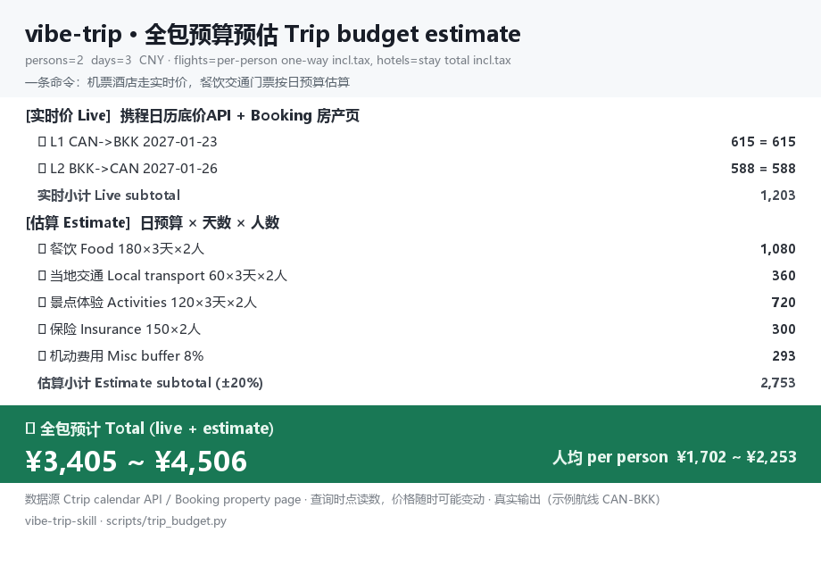

# vibe-trip-skill 🌏✈️

[](LICENSE)
[](https://github.com/SPA3K/vibe-trip-skill/stargazers)
[](scripts/)
[](README.md)

**旅行パーソナリティ・ニーズ・予算の三つが驅使するオールインワン旅行スキル**：性格とニーズの対話から目的地と旅程を導き出し、複数ソースの価格比較、最後は cron が値下がりを継続監視します。旧名 `trip-planner`、2.0 で改名。

[English](README_EN.md) · [中文](README.md) · [한국어](README_KO.md)

| スタンドアロンスクリプト | カレンダー最低価格 | API 依存 | 通知 | ドキュメント |
|---|---|---|---|---|
| **6** 本 | **366** 日／1回 | **0** キー（現時点実測）・ログイン不要 | 変化なしなら出力なし | 4 言語 |

## 5 分で動く

依存ゼロで実際の価格が出せます（何もインストールする前に実行可能）：

```bash
python scripts/ctrip_lowest_price.py --dep CAN --arr BKK --date 2027-06-10 --window 3
```

> ⚠️ 渡すのは**都市コード**で空港コードではありません：北京は `BJS`（`PEK`/`PKX` ではない）。複数空港都市に空港コードを渡すとカレンダーがすべて 0 を返します（2026-11 実測）。

便名・時刻、ホテル価格の取得、値下がり監視には、ブラウザドライバを一度だけインストールします（CDP でローカル Chrome に接続、デフォルト `http://127.0.0.1:9333`）：

```bash
pip install playwright
python scripts/ctrip_flight_list.py --dep can --arr bkk --date 2027-06-10
```

## 課題 → 解決

| よくある課題 | このリポジトリの解決策 |
|---|---|
| 比較のため 10 タブ開いても古い価格 | 机票の最低価格は 1 コマンドで 366 日分、ホテルは物件ページの客室表を直接参照 |
| 値下がりスクリプトが深夜に暴走通知 | 静寂契約：変化なしなら出力ゼロ、過去最安更新時のみ 1 回通知 |
| Booking 検索ページが自動化に「空室なし」と嘘をつく | 物件ページの `#hprt-table` 客室表へ変更、キーワードで予約した客室を特定 |
| 携程の国際線ログイン壁が不安定 | `needUserLogin` を検知しログイン不要カレンダー API へフォールバック、監視が切れない |
| Windows の cron に bash がなく `.sh` が動かない | `vibe_trip_entry.py`（標準ライブラリのみ）が playwright 入りの Python を自動選択 |
| 2 人が同じ便に乗るか目視で照合 | 同機ペアリング：直行便経由の区間と中継区間を便名で自動照合、復路は同じ便を推奨 |

## オールインワンのワークフロー

| 段階 | 内容 |
|---|---|
| 1️⃣ 性格・好みの対話 | 旅行のテンポ、計画派 vs 流派、写真/グルメ/体験重視、リスク許容度 |
| 2️⃣ ニーズ収集 | 日程、人数、総予算、優先順位、明確な「NG リスト」 |
| 3️⃣ 目的地の決定 | 総予算で 2-3 案を比較、2 層の安全ハードル（CDC 疾病層は一票否決；政治層は予約時＋出発 15 日前に再確認） |
| 4️⃣ 構成と予算 | 宿泊予算を用途別に配分、9 項目の予算表を随時再校正 |
| 5️⃣ ホテル 4 軸検証 | 公式情報 × 実宿泊者の評 × 地図位置 × 同条件価格比較；身元のハードル（グループ ≠ ブランド） |
| 6️⃣ 日別旅程 | 交通を先に、リゾート地は詰め込まない |
| 7️⃣ 複数ソースの価格取得 | フライト＋ホテルをソース横断で比較（下表） |
| 8️⃣ 継続的な値下がり監視 | 過去最安アラート、同機ペアリング、旧予約の更新判断（次節） |

## 複数ソースの価格比較（現状：携程 / Booking / Agoda）

| 対象 | データソース | 重要な事実（2026-11 実測） |
|---|---|---|
| フライト最低価格 | 携程カレンダー API | **現時点で**ログイン不要・キー不要（第三者 API に依存、アクセス方針変更で失効しうる）；任意の都市ペアを 1 回で 366 日分 |
| フライト詳細 | 携程リストページ | 便名、発着時刻、直行便の全便名；国際線はログイン壁に当たったら安全に降格 |
| ホテル価格 | Booking 物件ページ | 客室表＋滞在合計＋無料キャンセル/不可返金の区分、客室キーワードで絞り |
| ホテル価格 | Agoda 物件ページ | 実払い = 取り消し線価格 − 割引；不可返金枠は DOM を遡って突合、取り違え防止 |



## 価格モニタリングの継続

- **過去最安ステートマシン**：`values / mins / alerted` の 3 キー。過去最安更新時のみ通知、値が変われば再送しない、閾値を上回ればキー解除
- **静寂契約**：no_agent cron の空 stdout = 静寂、イベントがある時だけ通知
- **複数区間・別注文ごとの監視**：各便、注文ごとの合計、全体合計がそれぞれ独立した過去最安を保持
- **同機ペアリング**：共通の復路は 2 人が同じ便を推奨、直行便と中継区間を便名で同機判定
- **旧予約の更新判断**：予約済み無料キャンセルホテルの表示価格が実払いを下回ったら通知、判断期限 = 無料キャンセル締切
- **基準価格閾値**：注文合計 ≤ 基準価格で追加通知

### デプロイ：自動で回す

```bash
# Linux / macOS（crontab -e）：9:30 と 21:30 に実行、変化なしなら出力ゼロ
30 9,21 * * * cd /path/to/vibe-trip-skill && python3 scripts/vibe_trip_monitor.py

# Windows：タスクスケジューラで python を直接実行（入口は .bash ではなく .py）
# Hermes：no_agent セントリルタスク、script は scripts/vibe_trip_entry.py、空 stdout = 静寂
```

状態は `vibe_trip_state.json`（過去最安/通知済みキーで重複防止）、設定は `scripts/config.example.json` をコピー；ブラウザ系スクリプトはデバッグポート付き Chrome 常設が必要（CDP `http://127.0.0.1:9333`）。

## パッケージ全体の予算見積り（showcase）

出発前に 1 コマンドで**パッケージ全体の予想費用**を算出：航空券とホテルは実勢価格、食費/市内交通/観光は入力した日次予算から見積り、総額レンジと一人あたりを表示。

```bash
python scripts/trip_budget.py
```



- 航空券は `budget.flight_order`（通常 `grand` = 全員合計）で人数分支給、ホテルは物件ページの滞在合計
- 人数/日数/日次予算/保険/予備費比率はすべて `config.budget`、見積り項目は自動で ±20% レンジ
- 航空券カレンダー API は CNY のみ、予算は CNY で集計；ホテル単体検索は `--currency` で通貨切替

## アーキテクチャ


## 導入方法：agent に自動インストールさせる

あなたの agent に 1 文だけ伝えれば OK：

> github.com/SPA3K/vibe-trip-skill を skill としてインストールして

agent がリポジトリを clone して skills ディレクトリへ置き（Hermes：`~/.hermes/skills/travel/`、Claude Code：`~/.claude/skills/`）、`SKILL.md` の 10 ステップに従います。

パッケージは 2 層で、インストール直後から使えます：

**プランニング層**：`SKILL.md` を読み 10 ステップを実行（ニーズ → 予算で目的地を絞り → 安全確認 → 構成 → ホテル検証 → 旅程 → 校正 → 価格取得 → 盯価 → 納品。出発 15 日前の二重再確認リスト付き）。

**ツール層**：`scripts/` の 6 本をコマンドラインで直接実行。

```bash
python scripts/ctrip_lowest_price.py --dep CAN --arr BKK --date 2027-06-10 --window 3
python scripts/ctrip_flight_list.py --dep can --arr bkk --date 2027-06-10
python scripts/hotel_price_check.py --platform booking \
  --url "https://www.booking.com/hotel/th/xxx.html" \
  --checkin 2027-06-10 --checkout 2027-06-17 --nights 7 --room-must Deluxe
python scripts/vibe_trip_monitor.py --verbose   # ローカルで 1 回監視テスト
```

ブラウザ系スクリプトは CDP で実ブラウザに接続（cua-driver と Playwright が同一エンドポイントを駆動）、QR ログイン状態を長期再利用。設定は `scripts/config.example.json` をローカルの `vibe_trip_config.json` へコピーし、実際の旅程パラメータはローカルのみ、リポジトリには入れません。

## リポジトリ構成

```
vibe-trip-skill/
├── README*.md                 # 4 言語ドキュメント（中/英/日/韓）
├── SKILL.md                   # skill 定義：10 ステップ + ツールボックス + Gotchas
├── LICENSE
├── assets/                    # 構成図 + データサンプル図（実行出力のレンダリング）
└── scripts/
    ├── ctrip_lowest_price.py  #   携程カレンダー最低価格（ログイン不要 API・標準ライブラリのみ）
    ├── ctrip_flight_list.py   #   携程リストページ（便名/時刻/直行）
    ├── hotel_price_check.py   #   Booking/Agoda ホテル価格照合
    ├── trip_budget.py         #   パッケージ予算見積り（showcase）
    ├── vibe_trip_monitor.py   #   複数区間+複数ホテルの監視ウォッチドッグ
    ├── vibe_trip_entry.py     #   cron エントリー（Windows の bash なしブリッジ）
    └── config.example.json    #   設定テンプレート（プレースホルダのみ）
```

## 致謝（謝辞）

- 靈感來源：[ai-goofish-monitor](https://github.com/Usagi-org/ai-goofish-monitor)。本リポジトリのセントリル cron、状態カーソルによる重複防止、静寂契約の 3 点セットは、それを基盤とする**閑魚価格監視 skill**（`xianyu-monitoring`）から借用しました。感謝します。
- 価格監視の技術的沼（PIPL 同意ウォール、リージョンフィルタ、通知の重複防止）はローカルの `devops/web-price-monitoring` skill と同系統で補完し合っています。

## 免責事項

価格はページの実時点読取値です。在庫・座席クラス・為替・会員特典により変動し、予約確定ページが基準となります。目的地の安全情報は大使館・領事館および権威ある機関の最新発表に従ってください。

## License

MIT。
