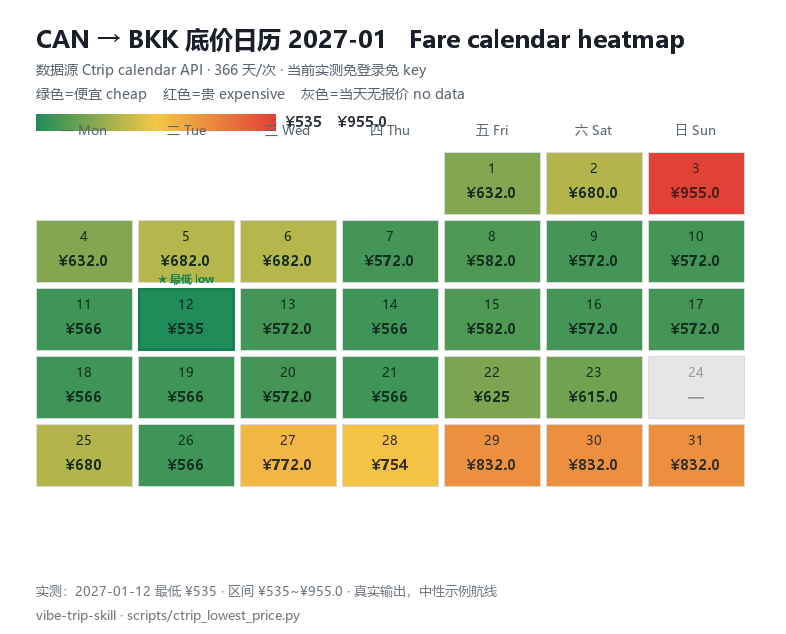
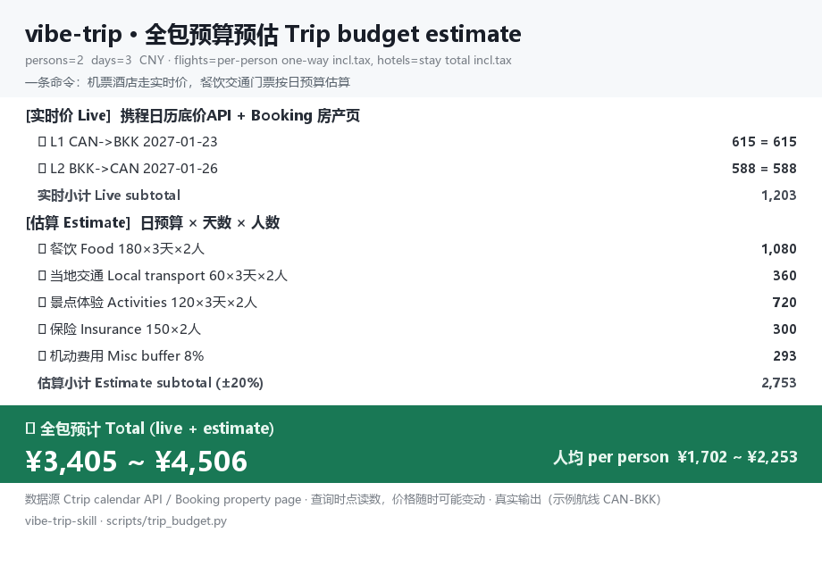

# vibe-trip-skill 🌏✈️

[](LICENSE)
[](https://github.com/SPA3K/vibe-trip-skill/stargazers)
[](scripts/)
[](README.md)

**여행 성격 + 니즈 + 예산이 함께 이끄는 올인원 여행 스킬**: 성격과 니즈 대화에서 목적지와 일정을 도출하고, 별도 소스에서 가격을 비교한 뒤, 마지막으로 cron이 지속적으로 가격을 감시합니다. 구명 `trip-planner`, 2.0에서 개명.

[English](README_EN.md) · [中文](README.md) · [日本語](README_JA.md)

| 스탠드얼론 스크립트 | 캘린더 최저가 | API 의존 | 알림 | 문서 |
|---|---|---|---|---|
| **6**개 | **366**일/1회 호출 | **0** 키 (현재 실측) · 로그인 불필요 | 변화 없으면 출력 없음 | 4개 언어 |

## 5분 만에 돌리기

의존성 없이 실제 가격을 바로 확인할 수 있습니다 (아무것도 설치하기 전에 실행 가능):

```bash
python scripts/ctrip_lowest_price.py --dep CAN --arr BKK --date 2027-06-10 --window 3
```

> ⚠️ 넘겨야 할 값은 **도시 코드**이지 공항 코드가 아닙니다: 베이징은 `BJS` (`PEK`/`PKX` 아님). 복수 공항 도시에 공항 코드를 넘기면 캘린더가 전부 0을 반환합니다 (2026-11 실측).

항공편 번호/시각, 호텔 가격 조회, 가격 감시에는 브라우저 드라이버를 한 번만 설치하세요 (CDP로 로컬 Chrome에 연결, 기본 `http://127.0.0.1:9333`):

```bash
pip install playwright
python scripts/ctrip_flight_list.py --dep can --arr bkk --date 2027-06-10
```

## 페인 포인트 → 해결

| 자주 겪는 문제 | 이 저장소의 해결 |
|---|---|
| 열 개 탭을 열어도 보이는 건 옛날 가격 | 항공 최저가는 명령 한 번으로 366일 캘린더, 호텔은 매물 페이지 객실 테이블 직접 조회 |
| 가격 감시 스크립트가 한밤에 도배 | 무음 계약: 변화 없으면 출력 제로, 역대 최저 갱신 시에만 1회 알림 |
| Booking 검색 페이지가 자동화에 "객실 없음"으로 허위 보고 | 매물 페이지 `#hprt-table` 객실 테이블로 우회, 키워드로 예약한 객실까지 특정 |
| 시내항공 국제선 로그인 벽이 불안정 | `needUserLogin` 감지 시 로그인 불필요 캘린더 API로 폴백, 감시 공백 없음 |
| Windows cron에 bash가 없어 `.sh`가 죽음 | `vibe_trip_entry.py` (표준 라이브러리 전용)가 playwright 있는 Python 자동 선택 |
| 두 사람이 같은 항공편인지 눈으로 대조 | 동기 페어링: 직항 경유 구간과 환승 구간을 항공편 번호로 자동 대조, 귀국편은 같은 편 추천 |

## 올인원 워크플로

| 단계 | 내용 |
|---|---|
| 1️⃣ 성격·선호 대화 | 여행 템포, 계획형 vs 즉흥형, 사진/맛집/체험 성향, 리스크 허용도 |
| 2️⃣ 니즈 수집 | 날짜, 인원, 총예산, 우선순위, 명확한 "싫은 것 리스트" |
| 3️⃣ 목적지 선정 | 총예산으로 2-3안 비교, 2층 안전 게이트 (CDC 질병층은 거부권; 정치층은 예약 시 + 출발 15일 전 재확인) |
| 4️⃣ 구조와 예산 | 숙소 예산을 용도별 배분, 9개 항목 예산표 상시 재보정 |
| 5️⃣ 호텔 4축 검증 | 공식 정보 × 실이용자 평 × 지도 위치 × 동일 조건 가격 비교; 신원 하드룰 (그룹 ≠ 브랜드) |
| 6️⃣ 일자 일정 | 교통 먼저, 리조트 일정은 비우기 |
| 7️⃣ 멀티 소스 조회 | 항공 + 호텔 소스 간 비교 (아래 표) |
| 8️⃣ 지속 가격 감시 | 역대 최저 알림, 동기 페어링, 기존 예약 갱신 판단 (다음 절) |

## 멀티 소스 가격 비교 (현재:携程 / Booking / Agoda)

| 대상 | 데이터 소스 | 핵심 사실 (2026-11 실측) |
|---|---|---|
| 항공 최저가 | 携程 캘린더 API | **현재 실측** 로그인·키 불필요 (서드파티 API 의존, 접근 정책 변경 시 실패 가능); 임의 도시 쌍을 한 번에 366일 |
| 항공 상세 | 携程 리스트 페이지 | 항공편 번호, 출도착 시각, 직항 전체 항공편 번호; 국제선은 로그인 벽 시 안전 폴백 |
| 호텔 가격 | Booking 매물 페이지 | 객실 테이블 + 숙박 총액 + 무료취소/환불불가 구분, 객실 키워드 필터 |
| 호텔 가격 | Agoda 매물 페이지 | 실결제 = 취소선 가격 − 할인; 환불불가 항은 DOM 상향 매칭으로 혼동 방지 |



## 지속 가격 감시

- **역대 최저 상태머신**: `values / mins / alerted` 3키. 역대 최저 갱신 시에만 보고, 값 변화 없으면 재발송 금지, 임계 상회 시 키 해제
- **무음 계약**: no_agent cron 빈 stdout = 무음, 이벤트가 있을 때만 알림
- **노선별·예약별 감시**: 각 구간, 주문별 합계, 전체 합계가 각자 독립된 역대 최저 유지
- **동기 페어링**: 공유 귀국편은 두 사람이 같은 편 추천, 직항 경유와 환승을 항공편 번호로 동기 판정
- **기존 예약 갱신**: 예약한 무료취소 호텔의 표시가가 실결제 이하로 떨어지면 알림, 판단 창구 = 무료취소 마감일
- **기준가 임계값**: 주문 합계 ≤ 기준가 추가 알림

### 배포: 알아서 돌리기

```bash
# Linux / macOS (crontab -e): 9:30과 21:30 실행, 변화 없으면 출력 제로
30 9,21 * * * cd /path/to/vibe-trip-skill && python3 scripts/vibe_trip_monitor.py

# Windows: 작업 스케줄러가 python 직접 실행 (진입점은 .py, bash 불필요)
# Hermes: no_agent 센트리 잡, script는 scripts/vibe_trip_entry.py, 빈 stdout = 무음
```

상태는 `vibe_trip_state.json` (역대 최저/알림 키로 중복 방지), 설정은 `scripts/config.example.json` 복사; 브라우저 스크립트는 디버그 포트 Chrome 상주 필요 (CDP `http://127.0.0.1:9333`).

## 패키지 전체 예상 비용 (showcase)

출발 전 명령 한 번으로 **패키지 전체 예상 비용** 산출: 항공·호텔은 실시간 가격, 식비/시내교통/관광은 입력한 일 예산으로 추정, 총액 범위와 1인당 금액 출력.

```bash
python scripts/trip_budget.py
```



- 항공은 `budget.flight_order` (보통 `grand` = 전원 합계)로 인원별 전개, 호주는 매물 페이지 숙박 총액
- 인원/일수/일 예산/보험/예비 비율은 전부 `config.budget`, 추정 항목은 자동 ±20% 범위
- 항공 캘린더 API는 CNY만 반환, 예산은 CNY로 집계; 호텔 단건 조회는 `--currency`로 통화 변경

## 아키텍처


## 도입 방법: agent가 자동 설치

당신의 agent에게 한 문장만 건네세요:

> github.com/SPA3K/vibe-trip-skill을 skill로 설치해줘

agent가 저장소를 clone해 skills 디렉터리에 넣고 (Hermes: `~/.hermes/skills/travel/`, Claude Code: `~/.claude/skills/`), `SKILL.md`의 10스텝을 따릅니다.

패키지는 2층 구조로 설치 즉시 사용 가능:

**플래닝 층**: `SKILL.md`를 읽고 10스텝 실행 (니즈 → 예산으로 목적지 선별 → 안전 점검 → 구조 → 호텔 검증 → 일정 → 보정 → 조회 → 감시 → 전달, 출발 15일 전 이중 재확인 체크리스트 포함).

**도구 층**: `scripts/` 6개 스크립트를 커맨드라인에서 직접 실행.

```bash
python scripts/ctrip_lowest_price.py --dep CAN --arr BKK --date 2027-06-10 --window 3
python scripts/ctrip_flight_list.py --dep can --arr bkk --date 2027-06-10
python scripts/hotel_price_check.py --platform booking \
  --url "https://www.booking.com/hotel/th/xxx.html" \
  --checkin 2027-06-10 --checkout 2027-06-17 --nights 7 --room-must Deluxe
python scripts/vibe_trip_monitor.py --verbose   # 로컬에서 1회 감시 테스트
```

브라우저 스크립트는 CDP로 실제 브라우저에 부착 (cua-driver와 Playwright가 같은 엔드포인트 구동), QR 로그인 상태 장기 재사용. 설정은 `scripts/config.example.json`을 로컬 `vibe_trip_config.json`으로 복사, 실제 일정 파라미터는 로컬에만 저장하고 저장소에는 넣지 않습니다.

## 저장소 구조

```
vibe-trip-skill/
├── README*.md                 # 4개 언어 문서 (중/영/일/한)
├── SKILL.md                   # skill 정의: 10스텝 + 툴박스 + Gotchas
├── LICENSE
├── assets/                    # 구조도 + 데이터 샘플 이미지 (실제 출력 렌더링)
└── scripts/
    ├── ctrip_lowest_price.py  #   携程 캘린더 최저가 (로그인 불필요 API, 표준 라이브러리만)
    ├── ctrip_flight_list.py   #   携程 리스트 페이지 (항공편/시각/경유)
    ├── hotel_price_check.py   #   Booking/Agoda 호텔 가격 비교
    ├── trip_budget.py         #   패키지 예산 추정 (showcase)
    ├── vibe_trip_monitor.py   #   다구간+다호텔 감시 워치독
    ├── vibe_trip_entry.py     #   cron 엔트리 (Windows bash 브리지)
    └── config.example.json    #   설정 템플릿 (플레이스홀더만)
```

## 감사의 말 (Acknowledgments)

- 영감의 원천: [ai-goofish-monitor](https://github.com/Usagi-org/ai-goofish-monitor). 이 저장소의 센트리 크론, 상태 커서 중복 방지, 무음 계약 3종은 그것을 기반으로 한 **闲鱼 가격 감시 skill**(`xianyu-monitoring`)에서 차용했습니다. 감사합니다.
- 가격 감시의 기술 늪 (PIPL 동의 벽, 리션 필터, 알림 중복 방지)은 로컬 `devops/web-price-monitoring` skill와 같은 계열로 상호 보완합니다.

## 면책 사항

가격은 페이지의 시점 스냅샷이며 재고·좌석 등급·환율·회원 혜택에 따라 변동합니다. 결제 확정 페이지가 기준입니다. 목적지 안전 정보는 대사관·영사관 및 공식 기관의 최신 공지를 따르세요.

## License

MIT.
